# DIL: Dynamic Interface Language

A reference for the language and its React renderer.

Each message evaluates expressions in its own bounded QuickJS worker. The default renderer uses an opaque-origin iframe; host and Shadow DOM modes support trusted React components in the application. Shadow DOM encapsulates styles without providing iframe containment. See [the agent specification](spec/genui.agent.md) for compact authoring guidance, including React Flow and Mermaid.

DIL describes an interactive document in a single text body. It combines Markdown, component tags, JavaScript expressions, state declarations, and conditional or repeated content. A host can send the document progressively: readers see completed content and can use its controls while the remaining source arrives.

Its familiar pieces are Markdown prose, JSX-like tags and expressions, React-style state pairs, and Svelte-style control-flow blocks.

The [showcase](apps/demo/src/showcase.dil) contains examples of the supported components. The [agent specification](spec/genui.agent.md) is a shorter reference for writing DIL.

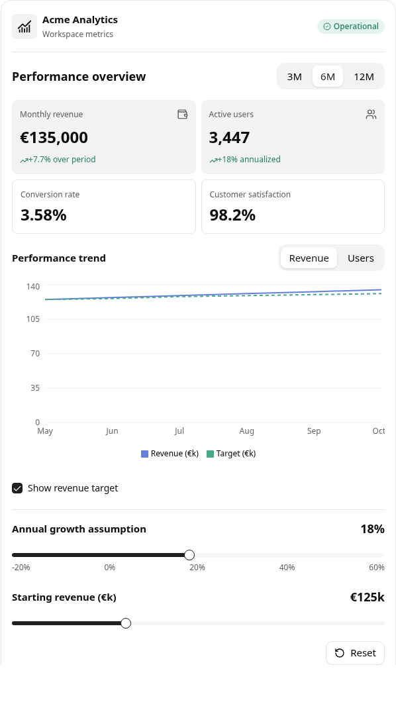

_The showcase dashboard. Changing the period, metric, growth assumption, or starting revenue updates the document's derived values and chart data._

## 1. Document model

A DIL document owns its state and expressions. Component tags describe the interface; the renderer maps them to React components. Event handlers update document state, and dependent expressions supply the next values to the interface.

For example, this complete document combines prose, a stateful control, a calculation, and conditional content:

```text
# Team estimate

{@body const [seats,setSeats] = DIL.useState(8)}
{@body const monthly = seats * 29}

<box border radius="xl" padding={4} gap={3}>
  <title size="xl">€{monthly.toFixed(2)} / month</title>
  <slider aria-label="Team members" min={1} max={50}
          value={seats} onChange={setSeats}/>
  {#if seats >= 20}
    <badge color="success">Large team</badge>
  {:else}
    <caption>{seats} seats selected</caption>
  {/if}
</box>
```

The document contains the calculation and event bindings. The host provides rendering, component implementations, and any explicitly supported services, such as clipboard access.

### React interface

The public entry point is [DilRenderer](packages/opendil/src/dil/dil-renderer.tsx):

```tsx
import { DilRenderer } from "@snackbit/opendil";
import "@snackbit/opendil/styles.css";

<DilRenderer key={messageId} text={text} isStreaming={isStreaming} />;
```

| Input         | Type                       | Contract                                                                       |
| ------------- | -------------------------- | ------------------------------------------------------------------------------ |
| `text`        | `string`                   | The complete source prefix received so far, growing by appending text.         |
| `isStreaming` | `boolean`, default `false` | `true` permits unfinished syntax; `false` finalizes the document.              |
| React `key`   | Host-selected identity     | Change it to replace the document, restart playback, and reset document state. |

Within one mounted renderer, each new `text` value must preserve the previous prefix. The renderer remembers its previous length and forwards only the suffix. It deliberately avoids comparing the entire prefix on each update. Same-length edits and changed prefixes are outside this contract; shortening the source or extending it after finalization reports a restart error.

Pause delivery by leaving `text` unchanged while keeping `isStreaming={true}`. Mark completion by setting `isStreaming={false}`, including when the last update adds no characters. A network or model transport belongs to the host. The demo grows a `text` field; the renderer does not own an SSE transport.

Source positions and chunk lengths use JavaScript UTF-16 code units. A network adapter must decode incoming bytes before appending them to `text`.

## 2. Language syntax

### Markdown and component tags

Markdown fragments support headings, emphasis, lists, tables, and fenced code through `react-markdown` and `remark-gfm`. They can appear between components and inside their content.

```text
## Infrastructure

<row align="center" justify="between" gap={2}>
  **Production services**
  <badge color="success">Healthy</badge>
</row>
```

Tags are case-sensitive. Use paired tags for content and `/>` for an empty component. The catalog includes lowercase tags such as `<box>` and capitalized adapters such as `<Chart>`.

Attributes accept three forms:

```text
<box border radius="xl" padding={4}>
  <text color={healthy ? "success" : "warning"}>{status}</text>
</box>
```

Here `border` is a boolean, `radius` is a quoted string, and `padding` is a JavaScript expression. Use braces for numeric values, objects, arrays, callbacks, or strings that need JavaScript escaping. JSX spread attributes and arbitrary React component imports are outside the supported authoring syntax.

### Declarations and state

`{@body ...}` introduces a document-scoped `const` declaration. Use one `const` statement per directive and unique binding names across the document.

```text
{@body const [count,setCount] = DIL.useState(0)}
{@body const doubled = count * 2}

<button onClick={() => setCount(previous => previous + 1)}>
  Increment
</button>
<text>{count} items; doubled: {doubled}</text>
```

The supported state form is `const [value,setter] = DIL.useState(initialValue)`. Initializers may be lazy functions, and setters accept either a replacement value or a function of the previous value.

`DIL.useState` is interpreted as a document-state declaration. It does not add a React hook to a growing component function. This permits state declarations to arrive later in the stream without changing React hook order.

State initializes once per binding name in the mounted document. Streaming updates and virtualized unmounts preserve it. Ordinary declarations such as `doubled` evaluate on demand inside the VM. Visible results are cached while refreshed values arrive asynchronously.

Declarations are document-scoped even when their source appears beside a later section. They do not capture an iteration's local bindings. General declaration destructuring is unsupported beyond the state pair above.

### Expressions and control flow

Expressions use JavaScript syntax for arithmetic, object and array literals, property access, template strings, array transformations, and callbacks. QuickJS evaluates them in its own JavaScript realm with a 64 MiB heap, a 1 MiB stack, and 50ms execution deadlines. This is a bounded JavaScript frontend, not a complete JSX or TypeScript compiler.

Inline expression results are converted to text. Component attributes can receive objects, arrays, and functions. Use DIL blocks to generate interface structure:

```text
{@body const plans = [
  {id:"starter", name:"Starter", price:12},
  {id:"pro", name:"Pro", price:29}
]}
{@body const [selected,setSelected] = DIL.useState("pro")}

{#each plans as plan,i}
  <button variant="outline" onClick={() => setSelected(plan.id)}>
    {i + 1}. {plan.name}: €{plan.price}
  </button>
{/each}

{#if selected === "pro"}
  <text>Pro selected</text>
{:else if selected === "starter"}
  <text>Starter selected</text>
{:else}
  <text>Choose a plan</text>
{/if}
```

Blocks can nest. An iteration introduces its item name and optional index into the rendering scope. Repeated items use a string or numeric `item.id` as their React key when available, otherwise their index. The runtime does not currently use arbitrary authored `key` expressions as a general identity policy.

### Literal code and SVG

`<CodeBlock language="typescript" editable>...</CodeBlock>` treats its body as literal source. Braces and TypeScript generics inside it are displayed rather than interpreted as DIL. Editing changes the code block's local draft; it does not execute the code or rewrite the host's `text`.

Native SVG elements, attributes, and expressions support custom diagrams. SVG `<text>` remains an SVG text element, distinct from the document's `<text>` primitive.

## 3. Component capabilities

| Family                | Components                                             | Implemented behavior                                                                                        |
| --------------------- | ------------------------------------------------------ | ----------------------------------------------------------------------------------------------------------- |
| Layout                | `box`, `row`, `grid`, `grid-item`, `spacer`, `divider` | Flex and grid composition, alignment, wrapping, dimensions, spacing, borders, and clipping.                 |
| Text and status       | `text`, `title`, `caption`, `badge`, `icon`, `label`   | Typography, numeric formatting, semantic colors, and a finite Lucide icon catalog.                          |
| Input                 | `input`, `slider`, `checkbox`, `radio-group`, `radio`  | Controlled values, value-based callbacks, keyboard operation, and disabled states.                          |
| Actions and selection | `button`, `pressable`, `segmented-control`             | Click handlers, selectable cards, plan and metric selectors, and conditional views.                         |
| Charts                | `Chart`                                                | Reactive line, bar, donut/pie, and scatter charts through Recharts and the shadcn chart foundation.         |
| Structured data       | `table`, `table-row`, `table-cell`                     | Native table structure through shadcn components, including virtualized long row sets.                      |
| Media                 | `AsyncImage`, `carousel`, `carousel-item`              | Fixture image resolution, image-failure feedback, and an Embla-backed shadcn carousel.                      |
| Overlays              | `popover`, `popover-trigger`, `popover-content`        | Radix-backed opening, dismissal, placement, and focus behavior.                                             |
| Code                  | `CodeBlock`                                            | Literal code display, lightweight highlighting, editable drafts, and draft retention across virtualization. |

Interactive primitives use shadcn/ui and Radix foundations. The adapters translate their events into DIL values:

| Binding                                              | Callback argument      |
| ---------------------------------------------------- | ---------------------- |
| `input.onChange`                                     | String value.          |
| `slider.onChange`                                    | One numeric value.     |
| `checkbox.onChange`                                  | Boolean checked state. |
| `radio-group.onChange`, `segmented-control.onChange` | Selected string value. |
| `button.onClick`, `pressable.onClick`                | No DOM event argument. |

Use `aria-label` for an explicit control name. The showcase also has inferred names for its known bindings. `GenUI.copy(text)` writes to the browser clipboard; the calling `button` or `pressable` briefly shows a "Copied" or "Copy failed" tooltip.

### Layout and styling vocabulary

Numeric `padding` and `gap` values use a 4px scale: `padding={4}` means 16px. Padding can also be `{x:2,y:1}`. Dimensions accept CSS strings or numeric pixel values.

| Attribute                                     | Common supported values                                                                                        |
| --------------------------------------------- | -------------------------------------------------------------------------------------------------------------- |
| `radius`                                      | `sm`, `md`, `lg`, `xl`, `2xl`, `full`, or a CSS radius string.                                                 |
| `border`                                      | Boolean, or `{size:2,color:"strong"}`.                                                                         |
| `background`                                  | `surface-secondary`, `surface-tertiary`, or a CSS color.                                                       |
| `color`                                       | `default`, `primary`, `secondary`, `tertiary`, `success`, `warning`, `danger`, or a CSS color where supported. |
| `align` / `justify`                           | Alignment such as `start`, `center`, `end`, and `between` for justification.                                   |
| `columns`, `wrap`                             | Grid column count; row wrapping with `wrap="wrap"`.                                                            |
| `width`, `height`, `maxWidth`, `flex`, `clip` | Dimensions, flex sizing, and overflow clipping.                                                                |
| Text `size`                                   | `xs`, `sm`, `md`, `lg`, `xl`, `2xl`.                                                                           |

The supplied theme is light. Grids collapse to one column at viewport widths of 520px or less. Style handling is adapter-specific; arbitrary CSS props are not a general extension mechanism.

### Reactive applications inside a document

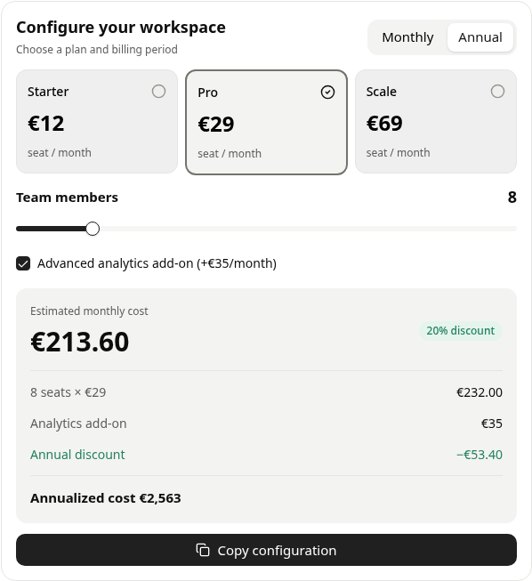

_The initial pricing state uses eight Pro seats, a €35 add-on, and the annual 20% discount: `(8 × 29 + 35) × 0.8 = €213.60` per month._

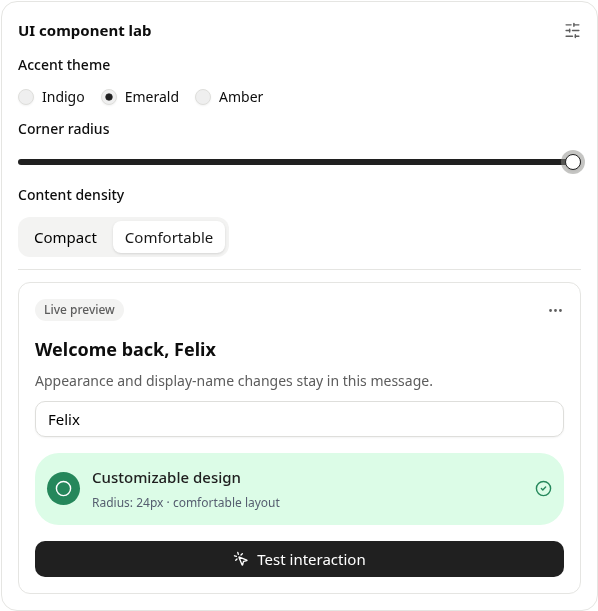

_State affects text, appearance, spacing, and event feedback within the same source document._

### Charts, diagrams, and media

`Chart` accepts a `content` object. Supported fields are `chartType`, `data`, `series`, and `xKey`, with `nameKey` and `valueKey` for pie charts. A series contains `dataKey` and `label`. The adapter implements these selected fields; extra captured chart metadata is not a general Recharts configuration interface.

```text
<Chart content={{
  chartType:"bar",
  xKey:"region",
  series:[{dataKey:"count",label:"Deployments"}],
  data:[{region:"EU",count:94},{region:"US",count:78}]
}}/>
```

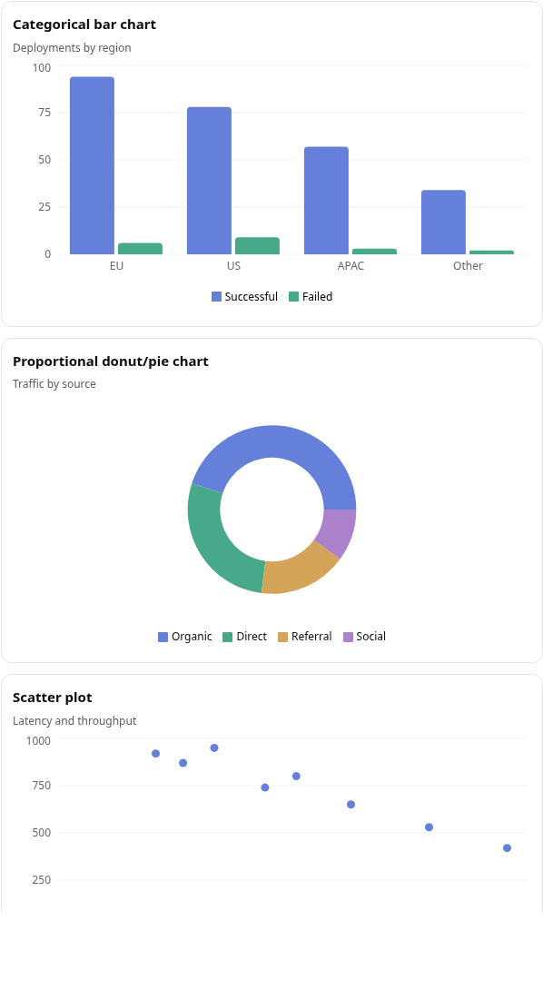

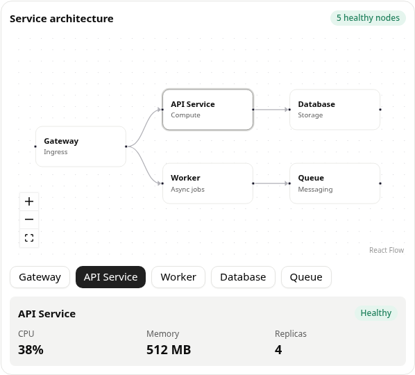

_The service selection updates both the graph and its detail panel._

NodeGraph uses string IDs, labels, optional subtitles in `sub`, optional x/y positions, and edges with source/target IDs. Coordinates guide the layout; columns expand to reserve at least 64 graph-coordinate pixels between node cards, and overlapping rows separate vertically. Its adapter caps previews at 200 nodes and 400 edges. Mermaid accepts a source string, also supports fenced mermaid blocks, and uses its own strict renderer with sanitized output.

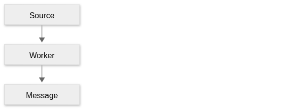

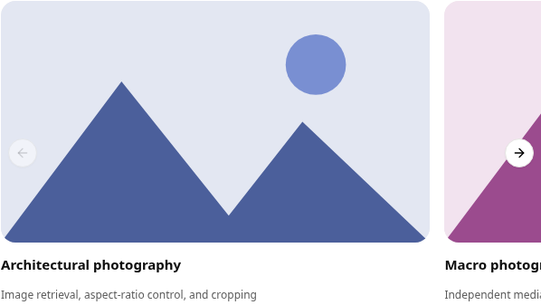

`AsyncImage` renders an offline geometric SVG illustration tinted by its query. It has no live image-search integration; a host-mode component override can supply an image service. Failed image loads show an unavailable state within the reserved media frame.

## 4. Rendering architecture

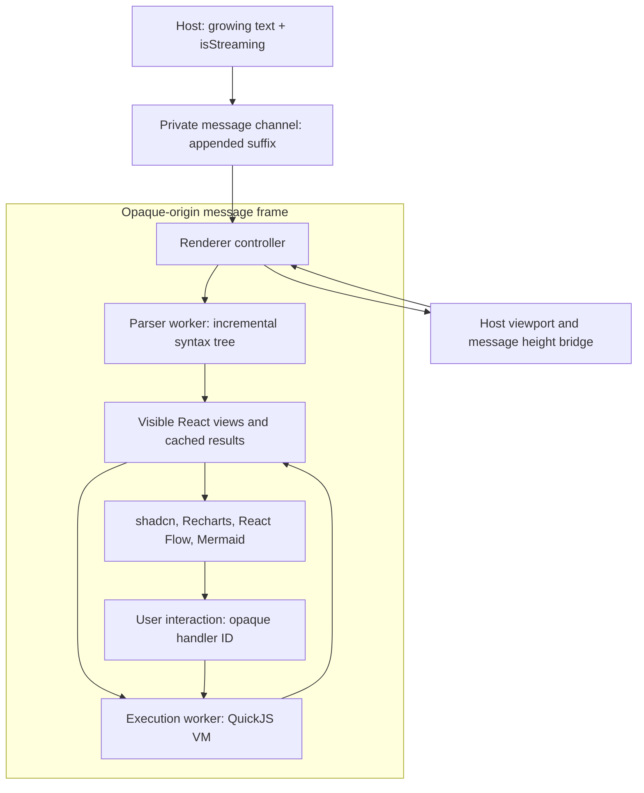

### Incremental tree construction

The [parser](packages/opendil/src/dil/parser/dil-parser.ts) retains its cursor, lexical state, open-element stack, and open directive frames across appends. It recognizes quoted strings, template strings, comments, expression braces, and code regions before interpreting DIL boundaries. Closed source tokens are not scanned again.

Each node receives an ID when it first appears. An unfinished opening tag can create a `pending` node; completion upgrades that same node to an element. The worker publishes changed node records and appended parent-child links rather than serializing the entire tree on each update.

The internal `TreeBatch` carries a revision, changed nodes, child links, new declarations, completion status, and the scanned source offset. Individual nodes carry a kind, component name, attributes, content, source offset, and a `streaming`, `ready`, or `error` status. A small lookahead buffer means the scanned position can trail the input by a few code units while streaming.

The worker processes tasks of at most 16,384 code units and yields between tasks. Main-thread publication coalesces pending worker messages once per animation frame, preserving declaration and child-link order and keeping the latest record for each changed node ID.

### State and expression evaluation

The [document runtime](packages/opendil/src/dil/runtime/document.ts) stores parsed nodes outside mounted widgets. Document state and callbacks live in the VM worker. QuickJS records the state bindings read by each evaluation and changed by each callback. Zustand subscriptions invalidate dependent expressions rather than refreshing the entire document on every keystroke. New declarations and unknown dependencies retain conservative invalidation.

Controls retain local drafts until an evaluated value acknowledges their latest interaction revision. Older worker results cannot overwrite newer typing or composition. Superseded direct-setter values may coalesce; arbitrary callbacks remain ordered, and subsequent actions flush pending setters before executing.

The [expression bridge](packages/opendil/src/dil/runtime/expressions.ts) exchanges scoped requests, serialized results, and opaque callback handles with the execution worker. Native browser functions never evaluate authored expressions. Only the worker VM sees executable source. A pure formatting bridge supplies the showcase's number formatting.

Hostile JavaScript cannot access browser DOM, storage, networking, or another message's VM. The frame uses `sandbox="allow-scripts"` without `allow-same-origin`, a restrictive CSP, and a private message channel. Clipboard writes require a trusted click on a document `button` or `pressable`, which authorizes one action, plus active browser user activation, then pass through a one-shot host broker. Parsed source is limited to five million UTF-16 code units and 100,000 syntax nodes. A one-second bridge watchdog terminates a stalled worker. Expressions, result payloads, nesting, arrays, text blocks, and code previews have additional limits. Rendering libraries remain trusted code and process bounded, validated input.

The visual system uses renderer-scoped CSS and semantic tokens for spacing, radii, surfaces, and colors. Host and Shadow DOM modes accept theme tokens, class overrides, component registrations, and component configuration; see the [customization API](README.md#isolation-and-customization). Recharts renders data charts, React Flow renders `NodeGraph`, and Mermaid renders bounded, sanitized diagram descriptions.

Markdown fragments pass through `react-markdown`; `remend` supplies temporary repairs for unfinished formatting during streaming. Code blocks remain literal, and SVG descendants use SVG rendering semantics.

## 5. Streaming and reveal

`progressiveReveal` is off by default. Pass `true` for the default fade, or `{ staggerMs, durationMs }` for custom timing. Values must be finite and nonnegative. Reveal waves are capped after six stagger intervals; reduced motion reveals content immediately. Layout containers do not add extra delays, and returning virtualized content stays revealed.

`updateInterval` defaults to `"instant"`. A finite nonnegative number limits streaming presentation commits to that interval in milliseconds; `0` is immediate. Source batches retain all declarations and links while keeping the latest node records. Expression notifications share the cadence. User actions and their binding refreshes remain immediate, as do native input drafts. Completion is committed through the same queue; unmounting cancels pending work.

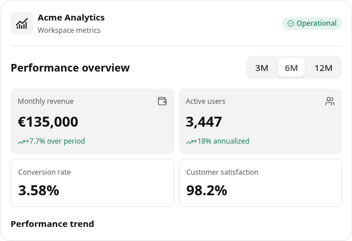

_Incomplete syntax does not introduce a guessed-size scaffold. Earlier controls remain usable._

| Source state                                      | Renderer behavior                                                                                |
| ------------------------------------------------- | ------------------------------------------------------------------------------------------------ |
| Readable prose arrives                            | Extend the current Markdown fragment and repair unfinished formatting for display.               |
| Opening tag or attribute expression is incomplete | Keep a pending component; do not evaluate incomplete JavaScript.                                 |
| Opening tag and layout attributes are ready       | Mount the actual component shell; controls remain disabled while their definition is unfinished. |
| Container opens                                   | Reveal its valid children before the enclosing section finishes.                                 |
| A control's own definition closes                 | Enable it; later sibling content may continue streaming.                                         |
| A required binding is unavailable                 | Keep previously committed content; otherwise wait without inventing placeholder dimensions.      |
| Source ends                                       | Flush trailing content and report unfinished structural syntax.                                  |
| A component is unsupported or fails to render     | Show a local error rather than replacing the whole document.                                     |
| Worker fails                                      | Retain received content, report the parser failure, and allow a host-driven restart.             |

Widget loading states use their real outer structure and sizing rules. Initially unknown-size asynchronous views appear when prepared; refreshes retain usable output. Natural content growth, wrapping, and state changes can grow or shrink a container. No maximum observed height is retained, and container height is not animated.

The runtime preserves completed component identities during normal appends. State lives independently of component mounts, so an input edited near the start of a stream is not reinitialized when a later declaration arrives.

## 6. Large documents and virtualization

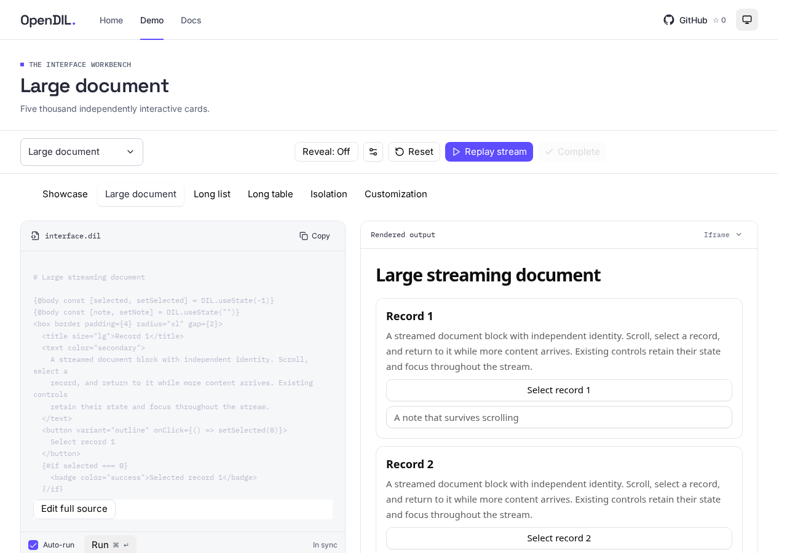

Virtualization activates above 100 presentable siblings in supported vertical flows or repeated item collections. Incomplete syntax and whitespace-only Markdown do not create virtual rows. Repeat templates expand after closing. The initial height estimate is 140px per item, with five overscan items on either side. Resize observation supplies measured heights; the node counter still includes nonvisual syntax records.

Unmeasured items occupy estimated space, and positions can shift as those estimates are replaced. The renderer does not establish a layout-shift budget for large documents.

Document flows, long repeated lists, and repeated table rows use window scrolling. Table virtualization preserves native rows and inserts spacer rows rather than putting layout divs into a table body. Charts and SVG diagrams remain atomic views.

Focused blocks and open-overlay anchors are pinned outside the normal visible range. The renderer also retains pinned blocks through the activation frame where the virtualizer may not yet have a measured viewport. Document state and code-editor drafts survive an offscreen unmount.

Set `autoScroll` to follow a streaming message. Wheel gestures in either direction, touch scrolling, scrollbar drags, and page-scroll keys pause following immediately, even beside the bottom. Call `resumeAutoScroll()` on the `DilRendererHandle` ref to resume. `onFollowChange` reports whether following is active. Rendering and virtualization adjustments do not count as reading gestures.

The object form accepts `{ behavior: "instant" | "smooth", padding: number }`; fields default to instant and zero. Padding must be finite and nonnegative. It scrolls beyond the message tail only where page space exists. Reduced motion forces instant behavior. Changing these settings does not resume following after a manual pause.

Smooth following uses one moving-target animation rather than restarting native smooth scrolling for every chunk. It retains fractional progress, suppresses competing scroll anchoring while engaged, and settles at the final rendered tail before releasing. Reading gestures cancel the loop immediately and restore page anchoring.

Virtualization bounds mounted UI, not source storage. Full source and syntax records remain in memory; reactive stores are allocated lazily when views request them. The implementation therefore retains document-sized memory costs. Arbitrary grid-cell virtualization and viewport rendering inside a single large chart or SVG are outside the current implementation.

A weighted render budget of 2,000 units limits mounted views, text, and visualization payloads, including nested repeats. Non-virtualized sibling lists and SVG iterations have additional caps. Exceeding a limit reports a local message error. Code highlighting falls back to plain display when its span count would exceed the display budget.

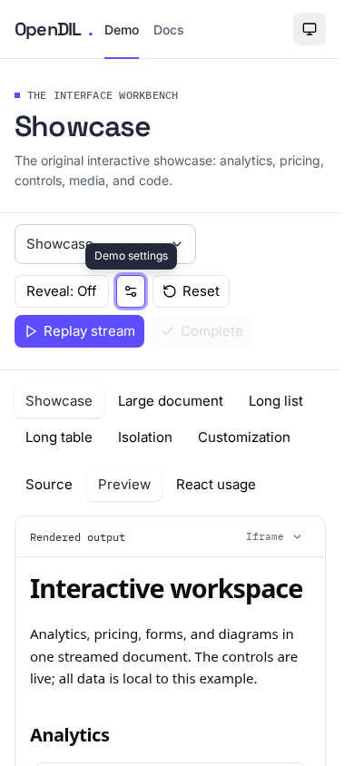

## 7. Limits

- DIL source is hostile executable input. It runs only in the message's QuickJS worker. Browser-side dynamic code evaluation is not used for authored input. The frame allows WebAssembly compilation for its worker but denies outbound connections, storage access, forms, and top navigation.
- The parser implements the supplied dialect and tested expression forms. It is not a complete MDX, HTML, JSX, TypeScript, or original-producer compatibility layer. Prefer fenced code or `CodeBlock` for literal code examples.
- Streaming is append-only within a mount. Source replacement, rollback, arbitrary reordering, and reconnect reconciliation require host policy or a new renderer instance.
- Runtime failures stop the affected message's worker and report one message error while preserving readable content. Pending conditional evaluations retain their prior branch. Custom React component failures use a local boundary; their own event handlers still execute with the application's privileges.
- Iteration identity falls back to position when items lack `id`; code-draft identities also include iteration position. General reordering guarantees remain outside the current implementation.
- Stock images use original offline illustrations and icon names use finite mappings. Chart adapters handle selected fields. Extra source attributes can be ignored, and unknown component names produce a local error.
- Maps, live weather, product search, document export, and file creation have no runtime adapters here. Statements about them in the captured showcase prose are source content, not implemented renderer features.
- The renderer requires browser JavaScript, Web Workers, and WebAssembly. Astro builds the static website and documentation, while React islands run live examples. Package consumers supply their own application shell. The renderer does not own document persistence or transport.

## 8. Development

```sh
npm ci
npm run build
npm run check
npm run test:e2e
npm run check:package
```

`npm run dev` starts the demo on port 5173. Settings offer iframe, Shadow DOM, and host rendering, reveal timing, scroll behavior, and padding. Normal replay uses `o200k_base` tokens at 1–1000 tokens/sec, defaulting to 150. Auto-scroll starts enabled; demo reveal timing starts at a 100 ms step delay and 220 ms fade. The rate input is exact and the slider is logarithmic. Tokenization happens once per selected source in a demo worker; paused or hidden time produces no catch-up burst. `npm run capture` refreshes screenshots and prints explicitly selected character-workload benchmarks, separate from token-paced replay.

Run `npm run check:rebuild` after changing the build system to check that live Vite imports stay available during a rebuild.

Useful implementation entry points:

| Responsibility                                    | Source                                                                                                                                     |
| ------------------------------------------------- | ------------------------------------------------------------------------------------------------------------------------------------------ |
| Public React contract and worker lifecycle        | [dil-renderer.tsx](packages/opendil/src/dil/dil-renderer.tsx)                                                                              |
| Incremental syntax and worker queue               | [parser](packages/opendil/src/dil/parser/dil-parser.ts), [worker](packages/opendil/src/dil/parser/stream-worker.ts)                        |
| State, derived values, and expression compilation | [document](packages/opendil/src/dil/runtime/document.ts), [expressions](packages/opendil/src/dil/runtime/expressions.ts)                   |
| Component vocabulary and event adapters           | [primitive registry](packages/opendil/src/dil/widgets/primitives/primitive.tsx), [controls](packages/opendil/src/dil/widgets/controls.tsx) |
| Virtualized flows and repeated templates          | [virtual-flow.tsx](packages/opendil/src/dil/view/virtual-flow.tsx), [repeated-nodes.tsx](packages/opendil/src/dil/view/repeated-nodes.tsx) |
| Reproducible workload and browser checks          | [fixtures](apps/demo/src/large-source.ts), [scale tests](tests/e2e/scale.spec.ts)                                                          |
