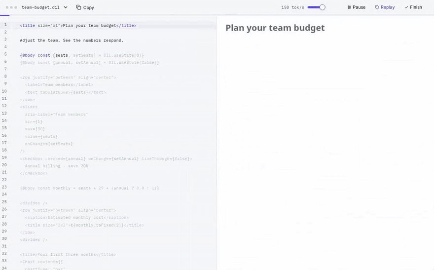
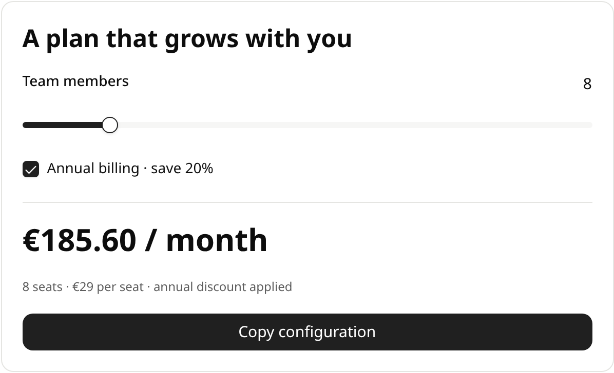

<div align="center">

# OpenDIL

**Interactive interfaces that stream in with your model's answer.**

[](https://www.npmjs.com/package/@snackbit/opendil)
[](https://github.com/snackbit/opendil/actions/workflows/ci.yml)
[](https://github.com/snackbit/opendil/blob/main/LICENSE)

[Website](https://opendil.com/) · [Playground](https://opendil.com/demo/) · [Docs](https://opendil.com/docs/getting-started/) · [Agent Spec](https://opendil.com/agent-spec/)



</div>

OpenDIL is a React renderer for DIL (Dynamic Interface Language): Markdown with components, charts, form controls, and a little reactive state. A language model writes DIL as plain text. Your app passes along whatever has arrived so far, and OpenDIL turns it into an interface people can use before the answer is finished.

We started OpenDIL after experimenting with ChatGPT's generative UI and wanting the same thing in our own products. It is an independent project with its own documented dialect.

## Quick start

### 1. Install

```sh
npm install @snackbit/opendil react react-dom
npx opendil copy-assets --out public/opendil
```

The second command copies the sandboxed runtime that the default iframe mode loads from `/opendil/`. Skip it if you only use host or Shadow DOM mode.

### 2. Teach your model DIL

Put the [Agent Spec](https://opendil.com/agent-spec/) in your system prompt. It covers the syntax, the stock components, and the output rules that keep documents safe to render. The source lives in [`spec/genui.agent.md`](https://github.com/snackbit/opendil/blob/main/spec/genui.agent.md).

### 3. Render the stream

```tsx
import { DilRenderer } from "@snackbit/opendil";
import "@snackbit/opendil/styles.css";

type AnswerProps = { id: string; text: string; streaming: boolean };

export function Answer({ id, text, streaming }: AnswerProps) {
  return (
    <DilRenderer key={id} text={text} isStreaming={streaming} autoScroll />
  );
}
```

Pass the full text received so far on every update and set `isStreaming={false}` after the last chunk. A new `key` starts a new document. OpenDIL never talks to your model provider, so it works with any client that streams text.

## What DIL looks like

```jsx
{@body const [seats, setSeats] = DIL.useState(8)}
{@body const [annual, setAnnual] = DIL.useState(true)}
<box border padding={5} radius="xl" gap={4}>
  <title size="xl">A plan that grows with you</title>
  <row justify="between">
    <label>Team members</label>
    <text>{seats}</text>
  </row>
  <slider
    aria-label="Team members"
    min={1}
    max={50}
    value={seats}
    onChange={setSeats}
  />
  <checkbox checked={annual} onChange={setAnnual} lineThrough={false}>
    Annual billing · save 20%
  </checkbox>
  <divider />
  <title size="2xl">€{(seats * 29 * (annual ? 0.8 : 1)).toFixed(2)} / month</title>
  <caption>{seats} seats · €29 per seat{annual ? " · annual discount applied" : ""}</caption>
  <button onClick={() => GenUI.copy(JSON.stringify({ seats, annual }))}>Copy configuration</button>
</box>
```



The slider and checkbox change document state, and the price recomputes from it. Expressions such as `seats * 29` run in a QuickJS WebAssembly worker with memory and execution limits. They never run as JavaScript in your page.

## Why OpenDIL

### Usable while it streams

OpenDIL parses the partial document on every update. Text, charts, and controls appear as soon as their source is complete enough, so a reader can drag a slider while the model is still writing the paragraph below it. Unfinished tags don't produce guessed-size skeletons, and a control keeps its place on screen while it becomes ready.

### Plain text a model can write

DIL reads like Markdown mixed with JSX, two formats models already produce well. A document needs no schema or tool call, and it can hold its own state, derived values, conditional views, and repeated content.

### Sandboxed by default

The default renderer draws stock components inside an opaque-origin iframe with a strict Content Security Policy and no network access. When you need your own React components, switch to host or Shadow DOM mode and decide what you trust.

### Built for long answers

Repeated content and large flows are virtualized, and active inputs keep their values while they scroll out of view. Our benchmark fixture renders 5,000 cards from about 2.4 MB of DIL.

## Components

| Group                                                     | Includes                                                                  |
| --------------------------------------------------------- | ------------------------------------------------------------------------- |
| [Text](https://opendil.com/docs/components/text/)         | Typography, captions, icons, and status badges                            |
| [Layout](https://opendil.com/docs/components/layout/)     | Boxes, rows, and responsive grids                                         |
| [Inputs](https://opendil.com/docs/components/inputs/)     | Text inputs, sliders, checkboxes, and radio groups                        |
| [Actions](https://opendil.com/docs/components/actions/)   | Buttons, pressable cards, segmented controls, and conditional navigation  |
| [Charts](https://opendil.com/docs/components/charts/)     | Line, bar, pie, and scatter charts with hover detail and series selection |
| [Tables](https://opendil.com/docs/components/tables/)     | Native tables and virtualized repeated rows                               |
| [Code](https://opendil.com/docs/components/code/)         | Highlighted source with editing, wrapping, and copy                       |
| [Diagrams](https://opendil.com/docs/components/diagrams/) | React Flow graphs, Mermaid diagrams, and SVG                              |
| [Media](https://opendil.com/docs/components/media/)       | Offline illustrations and an image carousel                               |
| [Overlays](https://opendil.com/docs/components/overlays/) | Popovers with keyboard support, collision handling, and focus restoration |

## Rendering modes

| Mode                   | Rendering boundary                        | Your own React components       |
| ---------------------- | ----------------------------------------- | ------------------------------- |
| `"isolated"` (default) | Sandboxed iframe without network access   | Requires a custom runtime build |
| `"shadow"`             | Shadow DOM scopes markup and styles       | Supported                       |
| `"host"`               | Renderer-scoped styles in your page's DOM | Supported                       |

All three modes keep DIL expressions in bounded QuickJS workers. Shadow DOM shares your page's JavaScript privileges, so use host and Shadow DOM mode only with documents and components you trust. The [isolation guide](https://opendil.com/docs/isolation/) covers the details.

## Bring your own components

In host or Shadow DOM mode you can register components for new tags or replace stock ones:

```tsx
import { DilRenderer, type DilComponentProps } from "@snackbit/opendil";
import "@snackbit/opendil/styles.css";

function Callout({
  children,
  className,
  config,
  presentationRef,
}: DilComponentProps) {
  return (
    <aside ref={presentationRef} className={className}>
      <strong>{String(config.label ?? "Note")}</strong>
      {children}
    </aside>
  );
}

// Keep the registry at module scope so React doesn't remount your components.
const components = { Callout };

export function Preview() {
  return (
    <DilRenderer
      mode="host"
      text="<Callout>Your application owns this component.</Callout>"
      components={components}
      componentConfig={{ Callout: { label: "From our design system" } }}
      tokens={{ "--primary": "#156f55", "--radius": "1rem" }}
    />
  );
}
```

Components receive evaluated attributes, so validate the values you accept and don't spread them onto DOM elements. Theming works through `appearance`, CSS variables in `tokens`, and per-tag `classNames`. Tailwind v4 projects can import `@snackbit/opendil/tailwind.css` instead of the compiled stylesheet. See [Customization](https://opendil.com/docs/customization/overview/).

## Streaming options

| Prop                | Default     | Effect                                                                         |
| ------------------- | ----------- | ------------------------------------------------------------------------------ |
| `progressiveReveal` | `false`     | Fades new blocks in sequence. `true` uses a 50 ms stagger and 180 ms fade.     |
| `updateInterval`    | `"instant"` | Pass milliseconds to batch presentation updates. User input stays immediate.   |
| `autoScroll`        | `false`     | Follows the stream until the reader scrolls. Accepts `behavior` and `padding`. |
| `onFollowChange`    |             | Reports whether the renderer is following, for a "Jump to latest" button.      |

Call `resumeAutoScroll()` on the renderer ref to start following again. The [renderer reference](https://opendil.com/docs/renderer/) lists every prop.

## Limits

DIL is a bounded document language. It doesn't compile arbitrary JSX or TypeScript, and the stock renderer has no maps, live weather, product search, or file export. Image components show offline illustrations; register a host component if you want to connect an image service.

OpenDIL needs React 19 and a browser with Web Workers, WebAssembly, and sandboxed iframes. Shadow DOM mode also needs constructable stylesheets (`adoptedStyleSheets`). The `opendil` asset CLI needs Node 22 or newer.

## Development

```sh
npm ci
npm run build
npm run check      # format, lint, typecheck, unit tests with coverage
npx playwright install chromium
npm run test:e2e
```

`npm run dev` rebuilds the package and starts the site on port 5173. The publishable renderer lives in `packages/opendil` and the website, playground, and docs in `apps/demo`. [CONTRIBUTING.md](https://github.com/snackbit/opendil/blob/main/CONTRIBUTING.md) covers the remaining checks and the release process. Report vulnerabilities as described in [SECURITY.md](https://github.com/snackbit/opendil/blob/main/SECURITY.md).

## License

Apache 2.0. See [LICENSE](https://github.com/snackbit/opendil/blob/main/LICENSE) and the [third-party notices](https://github.com/snackbit/opendil/blob/main/THIRD_PARTY_NOTICES.md).

## Who's behind OpenDIL

OpenDIL is made by [Felix Faust](https://turtledev.net). I'm open to freelance work, and paid projects help fund OpenDIL's development. If you have something in mind, reach out through [turtledev.net](https://turtledev.net).
