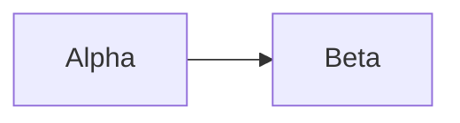

Choose `NodeGraph` for interactive architecture graphs, `Mermaid` for diagrams from text, and `svg` for custom drawings.

## `NodeGraph`

A graph of labeled nodes and edges that the reader can pan, zoom, and select from.

<LiveExample id="graph" />

**Usage**

```dil
{@body const [selectedId,setSelectedId] = DIL.useState("api")}
{@body const graph = {nodes:[{id:"api",label:"API",sub:"Entry",x:0,y:0},{id:"db",label:"Database",sub:"Storage",x:250,y:0}],edges:[{id:"api-db",source:"api",target:"db",label:"reads"}]}}
<NodeGraph content={graph} selectedId={selectedId} onSelect={setSelectedId}/>
<text>Selected service: {selectedId}</text>
```

**Attributes**

<ComponentProps name="NodeGraph" />

`content` holds two arrays:

- `nodes`: `{id, label, sub?, x?, y?}`. `label` is the main text and `sub` a second line. `x` and `y` are optional position hints.
- `edges`: `{id?, source, target, label?}`. `source` and `target` are node ids. Edges with unknown ids are dropped.

Positions are hints, not exact coordinates. The graph moves columns apart to keep at least 64 graph pixels between node cards, and moves nodes down so they do not overlap. Without positions, nodes fill three columns. Nodes and edges past the maximum counts are dropped; see [Component limits](/docs/limits/#components).

The graph is 320 px tall and has built-in pan and zoom controls. The reader cannot drag nodes or draw new edges.

**Callback value:** `onSelect` receives the clicked node's `id` as a string. Bind `selectedId` and `onSelect` to the same state, as in the example, so the selection stays visible and other content can react to it.

**Accessibility:** the graph has no accessible name that screen readers reliably announce. Put each node's description in `sub` rather than relying on position, and add a text summary of the graph nearby.

<Callout type="warn" title="Keyboard users cannot select nodes">
  `onSelect` fires only on a pointer click. Pressing Enter on a focused node
  does not call it. When the selection matters, also render a control bound to
  the same state, such as a `segmented-control` with one option per node.
</Callout>

```dil
{@body const [selectedId,setSelectedId] = DIL.useState("api")}
{@body const graph = {nodes:[{id:"api",label:"API",sub:"Entry"},{id:"db",label:"Database",sub:"Storage"}],edges:[{id:"api-db",source:"api",target:"db",label:"reads"}]}}
<NodeGraph content={graph} selectedId={selectedId} onSelect={setSelectedId}/>
<segmented-control aria-label="Selected service" value={selectedId} onChange={setSelectedId} options={graph.nodes.map(node => ({value:node.id,label:node.label}))}/>
```

**Styling:** `classNames` does not apply to `NodeGraph`.

<SpecExcerpt name="NodeGraph" />

## `Mermaid`

A diagram drawn from Mermaid source text, such as a flowchart or sequence diagram.

<LiveExample id="mermaid" />

**Usage**

```dil
<Mermaid source={"flowchart LR\n  Request --> Review\n  Review --> Ready"}/>
```

A Markdown fence with the language `mermaid` draws the same diagram:

````dil

````

**Attributes**

<ComponentProps name="Mermaid" />

OpenDIL runs Mermaid at its strict security level, without HTML labels, and sanitizes the SVG it produces, removing links and scripts. It shows "Unsupported or oversized Mermaid source" instead of a diagram when the source contains any of these:

- a `%%{` configuration directive;
- any `<` character, so no HTML;
- the text `click` or `classDef` followed by a space or line break, anywhere in the source. This includes node labels, so `A[Users click Save]` is rejected;
- a line that starts with `style` or `linkStyle`, or with `---` (which also rules out frontmatter).

Invalid or unfinished source shows "Diagram is incomplete or invalid". For the size limits, see [Component limits](/docs/limits/#components).

Mermaid diagrams are pictures. They have no selection or callbacks; use `NodeGraph` when the reader needs to pick a node.

**Accessibility:** a Mermaid diagram is an image of text that most screen readers cannot follow. Add a short text summary of what it shows.

**Styling:** Mermaid uses its neutral theme. `classNames` does not apply to `Mermaid`.

<SpecExcerpt name="Mermaid" />

## `svg`

A static vector drawing built from a safe subset of SVG.

<LiveExample id="vector" />

**Usage**

```dil
<caption>Static sample status drawing.</caption>
<svg viewBox="0 0 240 100" width="100%" height={100}>
  <g>
    <rect x={5} y={5} width={230} height={90} rx={8} fill="#eeeeff"/>
    <circle cx={35} cy={50} r={12} fill="#16794b"/>
    <text x={60} y={56} fontSize={18} fill="#252838">Ready</text>
  </g>
</svg>
```

**Attributes**

<ComponentProps name="svg" />

Inside `svg`, these elements are available: `svg`, `defs`, `marker`, `path`, `rect`, `circle`, `line`, `polyline`, `polygon`, `g`, `ellipse`, `text`, `tspan`, `linearGradient`, and `stop`. They share one list of allowed attributes. A `text` element inside `svg` is SVG text, not the DIL [`text`](/docs/components/text/#text) tag.

What is not available:

- `transform`, `points`, `x1`/`y1`/`x2`/`y2`, `offset`, and `stopColor`. Draw lines and polygons with `path`, and use solid fills instead of gradients.
- `href`, external images, `style`, `className`, scripts, `foreignObject`, and event handlers.
- References other than local ones such as `markerEnd="url(#arrow)"`.

Colors in SVG are literal values such as `#5e4cff`, `currentColor`, or `none`. The DIL color names do not apply. A repeated list of SVG items has its own cap; see [Display limits](/docs/limits/#display).

**Accessibility:** `svg` has no `aria-label`. Describe the drawing in nearby text and keep important values in text too. Never draw something that looks like a button or input; use the real component next to the drawing.

**Styling:** `classNames` does not apply to SVG elements.

<SpecExcerpt name="svg" />

## Next steps

<Cards>
  <Card
    title="Charts"
    href="/docs/components/charts/"
    description="Plot numbers as line, bar, scatter, and pie charts."
  />
  <Card
    title="Code blocks"
    href="/docs/components/code/"
    description="Show code, and learn how Mermaid fences fit with other fences."
  />
  <Card
    title="Limits"
    href="/docs/limits/#components"
    description="Check node, edge, and Mermaid size limits before generating large diagrams."
  />
</Cards>
