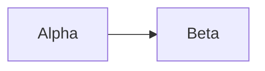

# GenUI Examples

Search `Component: slider`, `Composition: table`, `SVG element: path`, or
`Task: controlled-counter`. Every `dil` fence is an independent complete document.
Do not concatenate examples without renaming their document-wide declarations.
Data is synthetic unless a recipe explicitly describes supplied records.

Lookup index:

- Text: text, title, caption, badge, label, CodeBlock, Markdown.
- Media: AsyncImage.
- Layout: box, row, grid, grid-item, spacer, divider, table, table-row,
  table-cell, popover, popover-trigger, popover-content, carousel, carousel-item.
- Inputs: button, pressable, input, slider, checkbox, radio-group, radio,
  segmented-control.
- Visualizations: svg, Chart, NodeGraph, Mermaid; every allowed SVG descendant.
- Assets: icon and the complete supported-name gallery.
- Compositions: grid, table, popover, carousel, radio-group, SVG definitions,
  inline icons, nested layouts, conditional/repeated named children.
- Tasks: static-card, controlled-counter, conditional-status, dynamic-list,
  validation-form, host-action, external-data, incomplete-stream.

## 1. Output format and safety

#### Task: static-card

Generate source directly. This fence is for lookup and verification; a generated
UI response normally omits the surrounding fence.

```dil
<box border padding={4} radius="xl" gap={3} maxWidth={480}>
  <title>Release review</title>
  <text>Prepared for review.</text>
  <badge color="success"><icon name="circle-check"/> Ready</badge>
</box>
```

## 2. Syntax and parsing

### Markdown

#### Syntax: markdown-prose

```dil
# Review notes

**Two records** are ready. Values below are synthetic.

- Alpha: 12 units
- Beta: 18 units

| Record | Units |
| --- | --- |
| Alpha | 12 |
| Beta | 18 |

> Verify the source before making a decision.
```

#### Syntax: literal-code

CodeBlock, fenced code, and inline code spans protect braces and tags from DIL
parsing.

```dil
<CodeBlock language="text">
{literal braces}
<unsupported-example>This is displayed source.</unsupported-example>
</CodeBlock>
<text>A literal opening brace: {"{"}</text>

Pass `{ leading: false }` to `debounce`, and wrap the chart in a `<div>`.
```

### JavaScript expressions

#### Syntax: expressions-and-attributes

```dil
{@body const item = {name:"Alpha",amount:12}}
{@body const field = "name"}
<box border padding={{x:4,y:3}}>
  <text>{item[field]}: {item.amount * 2}</text>
  <caption>{`Original amount: ${item.amount.toFixed(1)}`}</caption>
</box>
```

### State declarations

#### Task: controlled-counter

Click Increment to update both the number and status. Reset restores zero.

```dil
{@body const [count,setCount] = DIL.useState(0)}
{@body const increment = () => setCount(previous => previous + 1)}
<row gap={2} align="center" wrap="wrap">
  <button onClick={increment}>Increment</button>
  <button variant="outline" onClick={() => setCount(0)}>Reset</button>
  <text tabularNums>Count: {count}</text>
</row>
{#if count > 0}<badge color="success">Started</badge>{:else}<caption>Waiting</caption>{/if}
```

### Conditional rendering

#### Task: conditional-status

```dil
{@body const [status,setStatus] = DIL.useState("waiting")}
<segmented-control aria-label="Status" value={status} onChange={setStatus} options={[{value:"waiting",label:"Waiting"},{value:"ready",label:"Ready"},{value:"blocked",label:"Blocked"}]}/>
{#if status === "ready"}
  <badge color="success">Ready</badge>
{:else if status === "blocked"}
  <badge color="danger">Blocked</badge>
{:else}
  <caption>Waiting</caption>
{/if}
```

#### Task: dynamic-list

IDs remain unique after removal and addition. Counter-based IDs are separate
from the current array length.

```dil
{@body const [items,setItems] = DIL.useState([{id:"item-1",name:"Item 1"}])}
{@body const [nextId,setNextId] = DIL.useState(2)}
<button onClick={() => { setItems(previous => [...previous,{id:`item-${nextId}`,name:`Item ${nextId}`}]); setNextId(previous => previous + 1); }}>Add item</button>
{#if items.length === 0}<caption>No items.</caption>{/if}
{#each items as item,index}
  <row gap={2} align="center">
    <text>{index + 1}. {item.name}</text>
    <button variant="ghost" onClick={() => setItems(previous => previous.filter(entry => entry.id !== item.id))}>Remove {item.name}</button>
  </row>
{/each}
```

#### Syntax: nested-each-scopes

```dil
{@body const groups = [{id:"review",name:"Review",items:[{id:"alpha",name:"Alpha"},{id:"beta",name:"Beta"}]}]}
{#each groups as group}
  <box border padding={3} gap={2}>
    <title>{group.name}</title>
    {#each group.items as item,index}<text>{group.name}: {index + 1}. {item.name}</text>{/each}
  </box>
{/each}
```

#### Task: incomplete-stream

Send the following unfinished prefix without signalling completion:

```text
<box padding={
```

Append `4}><text>Ready</text></box>`. Complete only after the combined document is:

```dil
<box padding={4}><text>Ready</text></box>
```

#### Syntax: streaming-repeat

The repeat waits for its closing directive. A first chunk can end here:

```text
{#each [{id:"a",name:"Alpha"}] as item}<text>{item.name}</text>
```

Append `{/each}` to finish this executable source:

```dil
{#each [{id:"a",name:"Alpha"}] as item}<text>{item.name}</text>{/each}
```

## 3. Component API

### Text components

#### Component: text

```dil
<text color="primary" size="lg" weight="medium" tabularNums>1,234 units</text>
```

#### Component: title

```dil
<title size="xl">Quarterly review</title>
```

#### Component: caption

```dil
<caption color="secondary">Synthetic values, shown in units.</caption>
```

#### Component: badge

```dil
<badge color="warning"><icon name="alert-triangle" size="xs"/> Needs review</badge>
```

#### Component: label

The sibling input names itself explicitly; label has no association prop.

```dil
{@body const [name,setName] = DIL.useState("")}
<label>Name</label>
<input aria-label="Name" value={name} onChange={setName}/>
```

#### Component: CodeBlock

Editing changes this widget's draft only. It does not execute the source or
update an authored state binding.

```dil
<CodeBlock language="javascript" editable>
const message = "Hello";
console.log(message);
</CodeBlock>
```

#### Component: Markdown

Braces, tags, and directives inside display literally.

```dil
<Markdown>
**Template:** Dear {name}, your order <Order id="1"/> has shipped.
</Markdown>
```

### Media components

#### Component: AsyncImage

```dil
<box maxWidth={480}>
  <AsyncImage query="Placeholder mountain landscape"/>
  <caption>Offline illustration, not a photograph.</caption>
</box>
```

### Layout components

#### Component: box

```dil
<box border={{size:1,color:"subtle"}} padding={{x:4,y:3}} radius="xl" background="surface-secondary" gap={2} maxWidth={480}>
  <title>Review panel</title><text>Two records are ready.</text>
</box>
```

#### Component: row

```dil
<row gap={2} align="center" justify="between" wrap="wrap">
  <text>Release status</text><badge color="success">Ready</badge>
</row>
```

#### Component: grid

```dil
<grid columns={2} gap={3}>
  <box border padding={3}><title>Alpha</title><text>12 units</text></box>
  <box border padding={3}><title>Beta</title><text>18 units</text></box>
</grid>
```

#### Component: grid-item

#### Composition: grid > grid-item

```dil
<grid columns={2} gap={3}>
  <grid-item border padding={3} radius="lg"><title>Alpha</title></grid-item>
  <grid-item border padding={3} radius="lg"><title>Beta</title></grid-item>
</grid>
```

#### Component: spacer

```dil
<row gap={2} align="center"><title>Review</title><spacer/><badge>Prepared</badge></row>
```

#### Component: divider

```dil
<box gap={3}><text>Overview</text><divider/><text>Details</text></box>
```

#### Component: table

#### Composition: table > table-row > table-cell

```dil
<table>
  <table-row><table-cell><text weight="medium">Name</text></table-cell><table-cell><text weight="medium">Units</text></table-cell></table-row>
  <table-row><table-cell>Alpha</table-cell><table-cell>12</table-cell></table-row>
</table>
```

#### Component: table-row

#### Composition: table > each > table-row

```dil
{@body const records = [{id:"a",name:"Alpha",amount:12},{id:"b",name:"Beta",amount:18}]}
<table>
  {#each records as item}<table-row><table-cell>{item.name}</table-cell><table-cell>{item.amount}</table-cell></table-row>{/each}
</table>
```

#### Component: table-cell

#### Composition: table-cell > generic content

```dil
<table>
  <table-row>
    <table-cell padding={3}><row gap={2} align="center"><icon name="package-check"/><text>Alpha</text></row></table-cell>
    <table-cell><badge color="success">Ready</badge></table-cell>
  </table-row>
</table>
```

#### Component: popover

#### Composition: popover > popover-trigger + popover-content

```dil
<popover>
  <popover-trigger><button variant="outline">Details</button></popover-trigger>
  <popover-content><text>Additional review notes.</text></popover-content>
</popover>
```

#### Component: popover-trigger

#### Composition: popover-trigger > button

```dil
<popover>
  <popover-trigger><button aria-label="Review details" variant="ghost"><icon name="info"/></button></popover-trigger>
  <popover-content><caption>No additional action required.</caption></popover-content>
</popover>
```

#### Component: popover-content

#### Composition: popover-content > generic content

```dil
{@body const [showNotes,setShowNotes] = DIL.useState(true)}
<popover>
  <popover-trigger><button variant="outline">Display options</button></popover-trigger>
  <popover-content side="top" align="end">
    <box gap={2}>
      <checkbox checked={showNotes} onChange={setShowNotes} lineThrough={false}>Show notes</checkbox>
      <caption>Selection: {showNotes ? "shown" : "hidden"}</caption>
    </box>
  </popover-content>
</popover>
{#if showNotes}<text>Review notes are visible.</text>{/if}
```

#### Component: carousel

#### Composition: carousel > carousel-item

```dil
<carousel>
  <carousel-item><box border padding={4}><title>Alpha</title><text>First option.</text></box></carousel-item>
  <carousel-item><box border padding={4}><title>Beta</title><text>Second option.</text></box></carousel-item>
</carousel>
```

#### Component: carousel-item

#### Composition: carousel > each > carousel-item

```dil
{@body const cards = [{id:"a",title:"Alpha"},{id:"b",title:"Beta"}]}
<carousel>
  {#each cards as card}<carousel-item><box border padding={4}><title>{card.title}</title></box></carousel-item>{/each}
</carousel>
```

#### Composition: box > grid > grid-item > row

```dil
<box gap={3}>
  <title>Sample overview</title>
  <grid columns={2} gap={3}>
    <grid-item border padding={3} radius="lg"><row gap={2} align="center"><icon name="wallet"/><text>12 units</text></row></grid-item>
    <grid-item border padding={3} radius="lg"><row gap={2} align="center"><icon name="users"/><text>3 reviewers</text></row></grid-item>
  </grid>
</box>
```

#### Composition: table > if > table-row

```dil
{@body const [showExtra,setShowExtra] = DIL.useState(false)}
<checkbox checked={showExtra} onChange={setShowExtra} lineThrough={false}>Show extra row</checkbox>
<table>
  <table-row><table-cell>Alpha</table-cell><table-cell>12</table-cell></table-row>
  {#if showExtra}<table-row><table-cell>Beta</table-cell><table-cell>18</table-cell></table-row>{/if}
</table>
```

### Input components

#### Component: button

```dil
{@body const [count,setCount] = DIL.useState(0)}
<button variant="outline" size="sm" onClick={() => setCount(previous => previous + 1)}>Add one</button>
<text>Count: {count}</text>
```

#### Component: pressable

#### Composition: pressable > noninteractive generic content

```dil
{@body const [selected,setSelected] = DIL.useState(false)}
<pressable border padding={4} radius="xl" gap={2} onClick={() => setSelected(previous => !previous)}>
  <title>Alpha option</title><text>Select this local option.</text>
  <badge>{selected ? "Selected" : "Not selected"}</badge>
</pressable>
```

#### Component: input

```dil
{@body const [name,setName] = DIL.useState("")}
<input aria-label="Display name" placeholder="Your name" value={name} onChange={setName}/>
<text>Hello, {name.trim() || "reader"}.</text>
```

#### Component: slider

```dil
{@body const [level,setLevel] = DIL.useState(40)}
<slider aria-label="Level" min={0} max={100} step={5} value={level} onChange={setLevel} marks={[{label:"Low"},{label:"High"}]}/>
<text tabularNums>Level: {level}%</text>
```

#### Component: checkbox

```dil
{@body const [done,setDone] = DIL.useState(false)}
<checkbox checked={done} onChange={setDone}>Review Alpha</checkbox>
<caption>{done ? "Review complete" : "Review pending"}</caption>
```

#### Component: radio-group

#### Composition: radio-group > radio

```dil
{@body const [billing,setBilling] = DIL.useState("monthly")}
<radio-group aria-label="Billing" value={billing} onChange={setBilling} direction="row">
  <radio value="monthly">Monthly</radio><radio value="annual">Annual</radio>
</radio-group>
<text>Billing: {billing}</text>
```

#### Component: radio

#### Composition: radio-group > each > radio

```dil
{@body const choices = [{id:"small",label:"Small"},{id:"large",label:"Large"}]}
{@body const [size,setSize] = DIL.useState("small")}
<radio-group aria-label="Size" value={size} onChange={setSize}>
  {#each choices as choice}<radio value={choice.id}>{choice.label}</radio>{/each}
</radio-group>
<caption>Selected: {size}</caption>
```

#### Component: segmented-control

```dil
{@body const [view,setView] = DIL.useState("summary")}
<segmented-control aria-label="View" value={view} onChange={setView} options={[{value:"summary",label:"Summary"},{value:"details",label:"Details"}]}/>
{#if view === "summary"}<text>Summary content.</text>{:else}<text>Detailed content.</text>{/if}
```

## 4. Specialized components

### Data-linked components

#### Task: external-data

These declarations represent records supplied in a prompt. The filter is local;
no provider, fetch, subscription, or write-back channel is created.

```dil
{@body const records = [{id:"a",name:"Alpha",amount:12},{id:"b",name:"Beta",amount:18}]}
{@body const [query,setQuery] = DIL.useState("")}
{@body const visible = records.filter(item => item.name.toLowerCase().includes(query.toLowerCase()))}
<input aria-label="Filter supplied records" value={query} onChange={setQuery}/>
{#if visible.length > 0}
  <table>{#each visible as item}<table-row><table-cell>{item["name"]}</table-cell><table-cell>{item.amount}</table-cell></table-row>{/each}</table>
{:else}
  <caption>No matching records.</caption>
{/if}
```

### Links and citations

#### Task: visible-source-url

No citation or navigable-link component exists. Display supplied references as
text; the explicit action below copies the address.

```dil
{@body const sourceUrl = "https://example.com/releases"}
<title>Supplied release notes</title>
<text>{sourceUrl}</text>
<button onClick={() => GenUI.copy(sourceUrl)}>Copy URL</button>
```

### Embedded application blocks

#### Task: local-application-panel

This is local UI composition. It does not embed or run another application.

```dil
{@body const [view,setView] = DIL.useState("overview")}
<box border padding={4} gap={3}>
  <title>Review workspace</title>
  <segmented-control aria-label="Workspace view" value={view} onChange={setView} options={[{value:"overview",label:"Overview"},{value:"notes",label:"Notes"}]}/>
  {#if view === "overview"}<text>Two records prepared.</text>{:else}<caption>Notes remain in this local document.</caption>{/if}
</box>
```

## 5. Visualizations

### Images

#### Component: svg

#### Composition: svg > g > rect + circle + text

```dil
<caption>Static sample status drawing.</caption>
<svg viewBox="0 0 240 100" width="100%" height={100}>
  <g>
    <rect x={5} y={5} width={230} height={90} rx={8} fill="#eeeeff"/>
    <circle cx={35} cy={50} r={12} fill="#16794b"/>
    <text x={60} y={56} fontSize={18} fill="#252838">Ready</text>
  </g>
</svg>
```

#### SVG element: defs

#### Composition: svg > defs > marker

```dil
<svg viewBox="0 0 200 50" width={200} height={50}>
  <defs><marker id="defs-arrow" markerWidth={10} markerHeight={10} refX={8} refY={3} orient="auto"><path d="M0 0 L8 3 L0 6 Z" fill="#5e4cff"/></marker></defs>
  <path d="M10 25 L180 25" stroke="#5e4cff" strokeWidth={2} markerEnd="url(#defs-arrow)"/>
</svg>
```

#### SVG element: marker

```dil
<svg viewBox="0 0 200 50" width={200} height={50}>
  <defs><marker id="marker-arrow" markerWidth={10} markerHeight={10} refX={8} refY={3} orient="auto"><path d="M0 0 L8 3 L0 6 Z" fill="currentColor"/></marker></defs>
  <path d="M10 25 L180 25" stroke="currentColor" strokeWidth={2} markerEnd="url(#marker-arrow)"/>
</svg>
```

#### SVG element: path

```dil
<svg viewBox="0 0 120 80" width={120} height={80}><path d="M10 65 L60 10 L110 65 Z" fill="#eeeeff" stroke="#5e4cff" strokeWidth={2}/></svg>
```

#### SVG element: rect

```dil
<svg viewBox="0 0 120 80" width={120} height={80}><rect x={10} y={10} width={100} height={60} rx={8} fill="#5e4cff"/></svg>
```

#### SVG element: circle

```dil
<svg viewBox="0 0 80 80" width={80} height={80}><circle cx={40} cy={40} r={25} fill="#16794b"/></svg>
```

#### SVG element: line

The element is recognized, but endpoint props x1/y1/x2/y2 are unavailable. Use
the path in this example for visible line geometry.

```dil
<svg viewBox="0 0 120 50" width={120} height={50}><line stroke="#5e4cff"/><path d="M10 25 L110 25" stroke="#5e4cff" strokeWidth={2}/></svg>
```

#### SVG element: polyline

Points is unavailable. The path shows the equivalent supported visible geometry.

```dil
<svg viewBox="0 0 120 80" width={120} height={80}><polyline fill="none" stroke="#5e4cff"/><path d="M10 60 L50 20 L100 60" fill="none" stroke="#5e4cff" strokeWidth={2}/></svg>
```

#### SVG element: polygon

Points is unavailable; use path for a visible closed polygon.

```dil
<svg viewBox="0 0 120 80" width={120} height={80}><polygon fill="#eeeeff"/><path d="M10 65 L60 10 L110 65 Z" fill="#eeeeff" stroke="#5e4cff"/></svg>
```

#### SVG element: g

```dil
<svg viewBox="0 0 140 80" width={140} height={80}><g fill="#5e4cff"><circle cx={35} cy={40} r={20}/><rect x={75} y={20} width={40} height={40}/></g></svg>
```

#### SVG element: ellipse

```dil
<svg viewBox="0 0 140 80" width={140} height={80}><ellipse cx={70} cy={40} rx={50} ry={25} fill="#eeeeff" stroke="#5e4cff"/></svg>
```

#### SVG element: text

Within SVG, text has SVG props and does not accept DIL color/size props.

```dil
<svg viewBox="0 0 160 60" width={160} height={60}><text x={10} y={35} fontSize={18} fontWeight={500} fill="currentColor">Alpha</text></svg>
```

#### SVG element: tspan

#### Composition: svg > text > tspan

```dil
<svg viewBox="0 0 180 80" width={180} height={80}><text x={10} y={25} fontSize={16} fill="currentColor">Alpha<tspan x={10} y={55}>12 sample units</tspan></text></svg>
```

#### SVG element: linearGradient

#### Composition: svg > defs > linearGradient > stop

The vocabulary recognizes gradient definitions, but offset/stopColor props are
unavailable. This demonstrates accepted composition only; use solid fills for
reliable authored color output.

```dil
<svg viewBox="0 0 120 60" width={120} height={60}>
  <defs><linearGradient id="limited-gradient"><stop/></linearGradient></defs>
  <rect x={10} y={10} width={100} height={40} fill="#5e4cff"/>
</svg>
```

#### SVG element: stop

```dil
<svg viewBox="0 0 120 60" width={120} height={60}>
  <defs><linearGradient id="limited-stop"><stop opacity={1}/></linearGradient></defs>
  <rect x={10} y={10} width={100} height={40} fill="#5e4cff"/>
</svg>
```

### Charts

#### Component: Chart

#### Chart type: line

```dil
<Chart content={{chartType:"line",data:[{month:"Jan",actual:10,plan:12},{month:"Feb",actual:15,plan:14}],xKey:"month",series:[{dataKey:"actual",label:"Actual"},{dataKey:"plan",label:"Plan"}]}}/>
<caption>Synthetic units. Actual rises from 10 to 15.</caption>
```

#### Chart type: bar

```dil
<Chart content={{chartType:"bar",data:[{name:"Alpha",amount:12},{name:"Beta",amount:18}],xKey:"name",series:[{dataKey:"amount",label:"Units"}]}}/>
<caption>Synthetic values: Alpha 12, Beta 18.</caption>
```

#### Chart type: scatter

```dil
<Chart content={{chartType:"scatter",data:[{hours:1,units:4},{hours:2,units:7},{hours:3,units:9}],xKey:"hours",series:[{dataKey:"units",label:"Units"}]}}/>
<caption>Synthetic relationship between hours and units.</caption>
```

#### Chart type: pie

```dil
<Chart content={{chartType:"pie",data:[{name:"Alpha",amount:30},{name:"Beta",amount:70}],nameKey:"name",valueKey:"amount"}}/>
<caption>Synthetic shares: Alpha 30%, Beta 70%.</caption>
```

#### Component: NodeGraph

```dil
{@body const [selectedId,setSelectedId] = DIL.useState("api")}
{@body const graph = {nodes:[{id:"api",label:"API",sub:"Entry",x:0,y:0},{id:"db",label:"Database",sub:"Storage",x:250,y:0}],edges:[{id:"api-db",source:"api",target:"db",label:"reads"}]}}
<NodeGraph content={graph} selectedId={selectedId} onSelect={setSelectedId}/>
<text>Selected service: {selectedId}</text>
```

#### Component: Mermaid

```dil
<Mermaid source={"flowchart LR\n  Request --> Review\n  Review --> Ready"}/>
```

#### Syntax: mermaid-markdown-fence

This complete DIL example contains a Markdown Mermaid fence. The outer four-backtick
fence belongs to this reference only; copy its inner source to the renderer.

````dil

````

### Maps

#### Task: location-data-without-map

No map/geocoding adapter exists. Display coordinates as supplied.

```dil
{@body const places = [{id:"berlin",name:"Berlin",lat:52.52,lon:13.405}]}
<table>{#each places as place}<table-row><table-cell>{place.name}</table-cell><table-cell>{place.lat}, {place.lon}</table-cell></table-row>{/each}</table>
<caption>No map or geocoding service is connected.</caption>
```

## 6. Interactivity

### State management

#### Task: immutable-record-updates

```dil
{@body const [tasks,setTasks] = DIL.useState([{id:"a",name:"Review Alpha",done:false},{id:"b",name:"Review Beta",done:false}])}
{@body const completeCount = tasks.filter(task => task.done).length}
<text>{completeCount} of {tasks.length} complete</text>
{#each tasks as task}
  <checkbox checked={task.done} onChange={checked => setTasks(previous => previous.map(entry => entry.id === task.id ? {...entry,done:checked} : entry))}>{task.name}</checkbox>
{/each}
```

### Event callbacks

#### Task: validation-form

The handler guards the action as well as disabling the control. No form or
server submission is implied.

```dil
{@body const [name,setName] = DIL.useState("")}
{@body const valid = name.trim().length >= 2 && name.trim().length <= 80}
<box gap={3} maxWidth={420}>
  <label>Name</label>
  <input aria-label="Name" value={name} onChange={setName} placeholder="At least two characters"/>
  {#if !valid}<caption color="danger">Enter a name between 2 and 80 characters.</caption>{/if}
  <button disabled={!valid} onClick={() => { if (valid) GenUI.copy(name.trim()); }}>Copy name</button>
</box>
```

### Data bindings

#### Task: computed-fields-and-derived-data

```dil
{@body const records = [{id:"a",name:"Alpha",amount:12},{id:"b",name:"Beta",amount:18}]}
{@body const field = "name"}
{@body const total = records.reduce((sum,item) => sum + item.amount,0)}
<text>Total: {total}</text>
{#each records as item}<text>{item[field]}: {item.amount}</text>{/each}
```

### Host actions

#### Task: host-action

```dil
{@body const report = "Review complete: Alpha and Beta checked."}
<button onClick={() => GenUI.copy(report)}><icon name="copy"/> Copy report</button>
```

#### Task: pressable-copy

```dil
<pressable border padding={4} radius="xl" gap={2} onClick={() => GenUI.copy("Alpha: 12 sample units")}>
  <title>Alpha</title><text>12 sample units</text><caption>Copy this summary</caption>
</pressable>
```

## 7. Assets

### Icons

#### Component: icon

#### Composition: button > icon + inline text

```dil
<button onClick={() => GenUI.copy("Review complete")}><icon name="copy" size="xs"/> Copy review</button>
```

#### Composition: button > icon with accessible action name

```dil
{@body const [count,setCount] = DIL.useState(1)}
<button aria-label="Reset count" variant="ghost" onClick={() => setCount(0)}><icon name="rotate-ccw"/></button>
<text>Count: {count}</text>
```

#### Assets: supported-icon-gallery

All supported names appear literally here for targeted searches. Icons are
decorative, so the gallery includes each name as visible text.

```dil
{@body const names = ["chart-no-axes-combined","circle-check","check-circle-2","circle","wallet","trending-up","users","rotate-ccw","copy","sliders-horizontal","ellipsis","sparkles","mouse-pointer-click","x","git-merge","package-check","shield-check","settings-2","info","code-2","alert-triangle"]}
<grid columns={2} gap={3}>
  {#each names as name}<row gap={2} align="center"><icon name={name} size="lg"/><text>{name}</text></row>{/each}
</grid>
```
